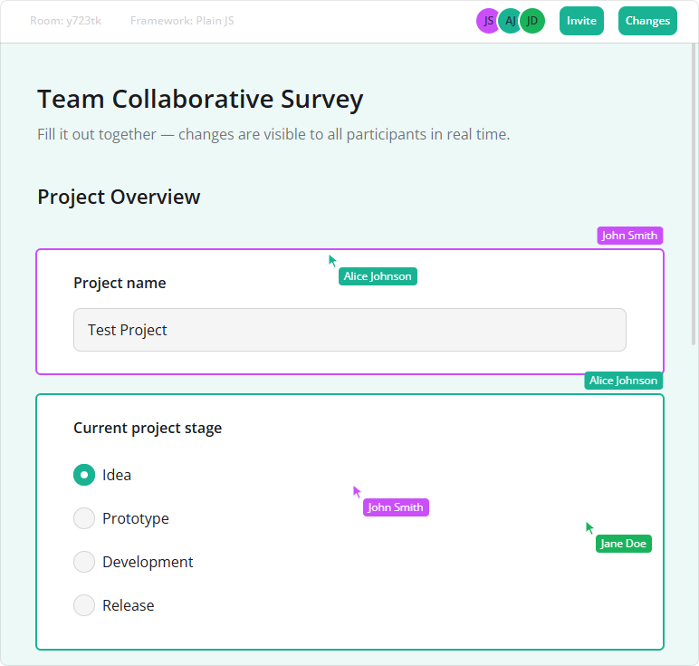

# Collaborative Form Filling

Collaborative form filling enables multiple participants to complete the same form at the same time. Each participant opens a local SurveyJS form instance connected to a shared room. Answer changes appear for everyone in that room, while presence indicators show participants' current questions and cursors.



SurveyJS Form Library provides a `CollaborationPlugin` that synchronizes answers and displays a participants bar, invite links, presence indicators, and change history. Your application supplies the connection and server that exchange updates between participants.

[Demo: Collaborative Form Filling](/form-library/examples/collaborative-survey/ (linkStyle))

## Use Cases

Collaborative form filling is useful when several people contribute to one response:

- Assisted data entry       
A support representative helps a customer complete a form while both see the same answers.

- Shared applications     
Team members complete different sections of an application, such as project details, schedules, and budgets.

- Joint reviews       
Participants review and correct a shared draft before submitting it.

All participants work on one shared answer set. Use separate response records when you need independent submissions from individual respondents. For collaboration on questions, choices, and form settings, see the following help topic:

[Documentation: Collaborative Form Editing](/survey-creator/documentation/multi-user-form-editing (linkStyle))

## Setup Instructions

### Run the Reference Application

The [Collaborative Form Filling repository](https://github.com/surveyjs/collaborative-form-filling) contains a Node.js server and React, Angular, Vue 3, and vanilla JavaScript clients. Participants using different clients can join the same room.

1. Clone the repository:
   ```sh
   git clone https://github.com/surveyjs/collaborative-form-filling.git
   cd collaborative-form-filling
   ```
2. Install dependencies, build the clients, and start the server:
   ```sh
   npm install
   npm run build
   npm run start
   ```
3. Open `http://localhost:3001`. In the lobby, select a framework, enter your display name, and create a room with a room ID. Use the sample form or provide your own survey JSON schema.
4. Click **Invite** and open the copied link in another browser tab, browser, or device that can reach the server. Join the same room and change an answer to verify that it appears for both participants.
 
A `localhost` link works only on the device running the server; use a reachable server address when inviting participants on other devices.

### Connect a Form in Your Application

Import `CollaborationPlugin` from `survey-core/collaboration` and include both the Form Library and collaboration stylesheets. The plugin does not open a network connection itself. Its `onEvent` event produces outgoing messages, and its `apply(message)` method accepts incoming messages.

In the following code, `surveyJson` is your form definition, `roomId` identifies the shared room, and `inviteUrl` is its join link:

```ts
import { Model } from "survey-core";
import { CollaborationPlugin } from "survey-core/collaboration";
import "survey-core/survey-core.css";
import "survey-core/collaboration.css";

const survey = new Model(surveyJson);
const collab = new CollaborationPlugin(survey, {
  info: [{ label: "Room", value: roomId }],
  getInviteLink: () => inviteUrl,
});

// Forward plugin events through your WebSocket connection.
collab.onEvent.add((_, { message }) => {
  if (ws.readyState === WebSocket.OPEN) {
    ws.send(JSON.stringify(message));
  }
});

// Apply messages from the server, including the initial room state.
ws.onmessage = (event) => collab.apply(JSON.parse(event.data));
```

Here, `ws` is a WebSocket connected to a server that follows the [collaboration protocol](https://github.com/surveyjs/collaborative-form-filling/blob/f511d54a3625a5299b6bdc9016d2a1e60a3ad239/PROTOCOL.md). Attach the message handler before the server sends the initial room state, then render `survey` with your framework's SurveyJS component.

When removing the form, call `collab.dispose()` and close the WebSocket connection. For message forwarding, reconnection, and cleanup, you can reuse the reference application's [WebSocket connection helper](https://github.com/surveyjs/collaborative-form-filling/blob/f511d54a3625a5299b6bdc9016d2a1e60a3ad239/shared/collab-client.ts). This helper is example application code rather than an export from a SurveyJS npm package.

### Set Up the Server and Storage

Run the reference server or implement its [collaboration protocol](https://github.com/surveyjs/collaborative-form-filling/blob/1896d51978f4ae369f7b810707eb07afee0721ad/PROTOCOL.md) in your preferred backend. For each room, the server keeps a form schema and an answer snapshot, sends the current state to new participants, and forwards answer and presence updates to other participants in that room. It must send the initial state before subsequent updates and preserve update order.

For production use, implement room access checks and save the shared response in your database. Define who can submit the response and when the room becomes read-only. Collaboration updates do not submit a completed response automatically&mdash;use your app's result storage workflow:

[Documentation: Store Survey Results](/form-library/documentation/how-to-store-survey-results (linkStyle))

File storage is also an application responsibility. Handle Form Library's [`onUploadFiles`](/form-library/documentation/api-reference/survey-data-model#onUploadFiles) and [`onClearFiles`](/form-library/documentation/api-reference/survey-data-model#onClearFiles) events and share the resulting file URLs as answer values. The reference application's file handling example demonstrates this approach:

[Example: File Handling](https://github.com/surveyjs/collaborative-form-filling/blob/f511d54a3625a5299b6bdc9016d2a1e60a3ad239/shared/fileSync.ts (linkStyle))

## Limitations

Keep these limitations in mind when using the plugin and reference app:

- Competing changes     
Synchronization uses last-write-wins at the question-value level. If participants update the same answer, a later update can replace an earlier one. Array and object answers, such as matrix or dynamic-panel values, are shared as whole values rather than merged field by field.

- Temporary storage in the reference server     
Rooms and uploaded files are stored in memory. A server restart clears them, and an empty room is deleted after its configured grace period. Add persistent storage if participants must return later.

- Offline changes       
The reference client replaces local answers with the server snapshot on reconnect. Changes made while disconnected are lost.

- Connection-scoped history       
The **Changes** panel contains edits observed during the current connection and resets when an initial state is reapplied. It does not provide a durable audit trail.

- Access control      
The reference application has no authentication or room authorization. An invite link or room ID alone does not establish a participant's permissions.

## See Also

- [Demo: Collaborative Form Filling](/form-library/examples/collaborative-survey/)
- [Demo: Collaborative Form Editing](/survey-creator/examples/collaborative-survey-creator/)
- [Documentation: Collaborative Form Editing](/survey-creator/documentation/multi-user-form-editing)
- [Documentation: Continue an Incomplete Survey](/form-library/documentation/how-to-save-and-restore-incomplete-survey)
